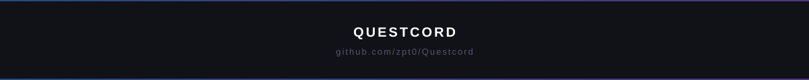

<p align="center">
  
</p>

<p align="center">
  <strong>A <a href="https://github.com/Vendicated/Vencord">Vencord</a> plugin that automates Discord Quests with real-time progress tracking.</strong>
</p>

<p align="center">
  <a href="https://github.com/zpt0/Questcord/actions/workflows/ci.yml">
    
  </a>
  <a href="https://github.com/zpt0/Questcord/releases">
    
  </a>
  <a href="https://github.com/zpt0/Questcord/blob/main/LICENSE">
    
  </a>
  <a href="https://discord.gg/sKTrAMctcy">
    
  </a>
</p>

---

> [!CAUTION]
> Discord has been stepping up enforcement against quest automation. Users have received quest access restrictions and account standing violations after running automation — any automation, not only Questcord. A ban or quest restriction is possible.
>
> That said, we have built Questcord to run quietly and carefully, and we consider the risk manageable when used normally. Everything we can do on our side to keep it safe is done — use it as intended and don't deliberately abuse it.
>
> The **achievement bypass** is the riskiest part: it opens a real Discord OAuth2 consent popup for the quest's application on your account, mints a proxy ticket, and posts forged progress either to a local relay on `127.0.0.1:43210` (tried first) or, as a fallback, to `https://<app>.discordsays.com/api/v1/achievements/progress`, then revokes the grant. It is **off by default** and stays behind a setting you must turn on yourself. If you would mind losing the account, do not run this on it.
>
> A telemetry blocker does not hide this: quest progress travels on the quest heartbeat, not on analytics.
>
> Use at your own risk.

---

<p align="center">
  <strong>📜 Changelog</strong> — see <a href="CHANGELOG.md">CHANGELOG.md</a> for release notes and per-version changes.
</p>

---

<h2 align="center">About</h2>

<p align="center">Questcord is a Vencord user plugin that completes Discord Quests automatically so you don't have to play them manually. It reads Discord's own quest stores, drives Discord's own authenticated API client, and shows real-time progress on pill overlays right in the Discord client.</p>

<p align="center">It does not talk to any Questcord server — there isn't one. Everything runs locally inside your Discord client.</p>

---

<h2 align="center">Features</h2>

<table align="center">
  <tr>
    <td align="center">
      
      <br/>
      <strong>Activity Quests</strong><br/>
      <sub>Auto-play activities</sub>
    </td>
    <td align="center">
      
      <br/>
      <strong>Stream Quests</strong><br/>
      <sub>Watch streams</sub>
    </td>
    <td align="center">
      
      <br/>
      <strong>Video Quests</strong><br/>
      <sub>Watch videos</sub>
    </td>
    <td align="center">
      
      <br/>
      <strong>Play Quests</strong><br/>
      <sub>Play games</sub>
    </td>
    <td align="center">
      
      <br/>
      <strong>Progress</strong><br/>
      <sub>Real-time tracking</sub>
    </td>
  </tr>
</table>

<h3 align="center">What it handles per quest type</h3>

<table align="center">
  <tr>
    <th align="left">Quest task</th>
    <th align="left">How it's completed</th>
  </tr>
  <tr>
    <td align="left"><code>WATCH_VIDEO</code>, <code>WATCH_VIDEO_ON_MOBILE</code>, <code>WATCH_VIDEO_ON_DESKTOP</code></td>
    <td align="left">Posts video progress timestamps on a randomized interval, with the fractional values a real player would send.</td>
  </tr>
  <tr>
    <td align="left"><code>PLAY_ON_DESKTOP</code></td>
    <td align="left">Spoofs a running game process into Discord's <code>RunningGameStore</code>, built from the app's real metadata. Discord then sends the quest heartbeats itself and Questcord reads the progress off the replies.</td>
  </tr>
  <tr>
    <td align="left"><code>STREAM_ON_DESKTOP</code></td>
    <td align="left">Same idea as play quests, plus a spoofed <code>getStreamerActiveStreamMetadata</code>. Discord requires a real Go Live with at least one viewer before it opens a heartbeat, so automation may not work here.</td>
  </tr>
  <tr>
    <td align="left"><code>PLAY_ACTIVITY</code></td>
    <td align="left">Heartbeats against a voice channel stream key. Subject to a <strong>25-minute hard cap per task</strong>.</td>
  </tr>
  <tr>
    <td align="left"><code>ACHIEVEMENT_IN_ACTIVITY</code></td>
    <td align="left">Tries the heartbeat first. Discord rejects those with a 403 because the activity backend validates them rather than the client, so it falls back to the OAuth path: authorize the quest's app on your account, mint a proxy ticket, post forged progress via the local relay on <code>127.0.0.1:43210</code> (tried first) or <code>discordsays.com</code> (fallback), then revoke the grant. <strong>Off by default.</strong></td>
  </tr>
  <tr>
    <td align="left"><code>ACHIEVEMENT_IN_GAME</code></td>
    <td align="left"><strong>Not possible.</strong> The achievement is earned in the retail game with the game linked to your account — nothing in Discord can stand in for that. Named in the log and skipped.</td>
  </tr>
  <tr>
    <td align="left"><code>PLAY_ON_XBOX</code>, <code>PLAY_ON_PLAYSTATION</code></td>
    <td align="left"><strong>Not automated.</strong> Console-only quest types are detected and filtered out by the queue; they cannot be completed through Discord's desktop client.</td>
  </tr>
</table>

---

<h2 align="center">Installation</h2>

<table align="center"><tr><td>

```bash
cd path/to/Vencord/src/userplugins
git clone https://github.com/zpt0/Questcord.git
cd Questcord
npm ci
npm run typecheck   # optional but recommended
```

</td></tr></table>

<p align="center">Rebuild Vencord, restart Discord, and enable <strong>Questcord</strong> in <code>Settings > Vencord > Plugins</code>.</p>

<p align="center">If you already build Vencord yourself, you can also add this repo via Vencord's <code>UserpluginInstaller</code> by pasting the repository URL.</p>

---

<h2 align="center">Usage</h2>

<p align="center">Enable the plugin → Quests auto-complete in the background → track progress in real-time on pill overlays.</p>

<h3 align="center">Queue</h3>

<p align="center">Quests can be added to a queue from Discord's quest tiles. The queue runs them automatically with a lane-based scheduler: game quests (limit=1) and video quests (limit=2) run in round-robin order with configurable concurrency. Console-only quests (XBOX / PLAYSTATION) are detected and excluded. Open the queue popout from any quest tile to see running, waiting, and completed quests.</p>

<h3 align="center">Settings</h3>

<p align="center">Questcord's settings live in <code>Settings > Vencord > Plugins > Questcord</code>. Key options:</p>

<table align="center">
  <tr>
    <th align="left">Setting</th>
    <th align="left">What it does</th>
    <th align="left">Default</th>
  </tr>
  <tr>
    <td align="left">Auto-start</td>
    <td align="left">Automatically start the engine on plugin load.</td>
    <td align="left">Off</td>
  </tr>
  <tr>
    <td align="left">Orb quests only</td>
    <td align="left">Only run quests that reward Orbs; skips quests with other reward types.</td>
    <td align="left">Off</td>
  </tr>
  <tr>
    <td align="left">Achievement bypass</td>
    <td align="left">Enable achievement-in-activity quest bypass via OAuth + local relay (<code>127.0.0.1:43210</code>, fallback <code>discordsays.com</code>). Off by default.</td>
    <td align="left">Off</td>
  </tr>
  <tr>
    <td align="left">Activity heartbeat</td>
    <td align="left">How often activity quests report progress (Fast / Balanced / Official pace — slower is safer on rate limits).</td>
    <td align="left">Fast</td>
  </tr>
  <tr>
    <td align="left">Play session tail</td>
    <td align="left">How long to keep the spoofed game running after quest completion (minutes, 0 = disabled).</td>
    <td align="left">2 min</td>
  </tr>
  <tr>
    <td align="left">Queue enabled</td>
    <td align="left">Run queued quests automatically via the queue popout.</td>
    <td align="left">On</td>
  </tr>
  <tr>
    <td align="left">Queue preference</td>
    <td align="left">Which kind of quest the queue runs first (Videos first / Games first).</td>
    <td align="left">Videos</td>
  </tr>
  <tr>
    <td align="left">Game concurrency</td>
    <td align="left">Max concurrent game quests (Discord only tracks one at a time).</td>
    <td align="left">1</td>
  </tr>
  <tr>
    <td align="left">Video concurrency</td>
    <td align="left">Max concurrent video quests.</td>
    <td align="left">2</td>
  </tr>
  <tr>
    <td align="left">Watch for enrollments</td>
    <td align="left">Auto-start the engine when you accept a quest in Discord's Quests page.</td>
    <td align="left">On</td>
  </tr>
  <tr>
    <td align="left">Auto dismiss popups</td>
    <td align="left">Automatically dismiss quest video and mobile QR code popups.</td>
    <td align="left">On</td>
  </tr>
  <tr>
    <td align="left">Auto restart stalled</td>
    <td align="left">Automatically restart quest automation once when progress stalls.</td>
    <td align="left">Off</td>
  </tr>
  <tr>
    <td align="left">Debug mode</td>
    <td align="left">Enable debug logging in the console (useful for troubleshooting).</td>
    <td align="left">Off</td>
  </tr>
  <tr>
    <td align="left">Show update notifications</td>
    <td align="left">Show notifications when a new version is available.</td>
    <td align="left">On</td>
  </tr>
  <tr>
    <td align="left">Pill position / colors / appearance</td>
    <td align="left">Customize where and how progress pills look on screen (position, background, accent, text, percent, bar, border colors, radius, font size, opacity, padding).</td>
    <td align="left">See settings</td>
  </tr>
</table>

---

<h2 align="center">How it works</h2>

<p align="center">Questcord reads Discord's own webpack stores (quests, running games, channel stores) and drives Discord's own authenticated API client. Stores are found by class name and shape, not by minified paths, so the plugin survives Discord renaming things between builds.</p>

<p align="center">Quest progress is shown on pill overlays in real time. A lane-based scheduler alternates video and game quests round-robin, with per-type concurrency limits. A centralized Traffic queue rate-limits Discord API calls (exponential backoff + jitter, per-request <code>AbortSignal</code>). A generation-based TaskControlRegistry manages task lifecycle with clean cancellation and pause/resume. Stall detection restarts automation when progress stops, and a watchdog gives up on quests Discord stops accepting (activity quests have a 25-minute hard cap).</p>

<p align="center">The UI is fully translated into <strong>10 locales</strong> (English, German, French, Spanish, Italian, Portuguese, Russian, Japanese, Korean, Chinese) with automatic fallback to English.</p>

---

<h2 align="center">Compatibility</h2>

<p align="center">Questcord is a Vencord plugin and requires Vencord installed on Discord desktop. It works on Discord Stable, Canary, and PTB where Vencord itself runs.</p>

<p align="center">Because Questcord reads Discord internals, any Discord update can break it — that's the nature of client mods in this space. Check <a href="CHANGELOG.md">CHANGELOG.md</a> for notes on what changed per version, and open an issue if quests stop working after a Discord update.</p>

---

<h2 align="center">Contributing</h2>

<p align="center">See <a href="CONTRIBUTING.md">CONTRIBUTING.md</a> for setup instructions, available scripts (<code>npm run typecheck</code>, <code>npm test</code>, <code>npm run lint</code>, <code>npm run format</code>), and guidelines.</p>

<p align="center">
  <a href="https://github.com/zpt0/Questcord/graphs/contributors">
    
  </a>
</p>

---

<h2 align="center">Support</h2>

<p align="center">
  <a href="https://github.com/zpt0/Questcord/issues/new?template=bug_report.yml">Report a Bug</a> ·
  <a href="https://github.com/zpt0/Questcord/issues/new?template=feature_request.yml">Request a Feature</a> ·
  <a href="https://discord.gg/sKTrAMctcy">Discord Server</a>
</p>

---

<p align="center">
  <sub>Made with ❤️ by <a href="https://github.com/zpt0">zpt0</a></sub>
</p>

<p align="center">
  
</p>
